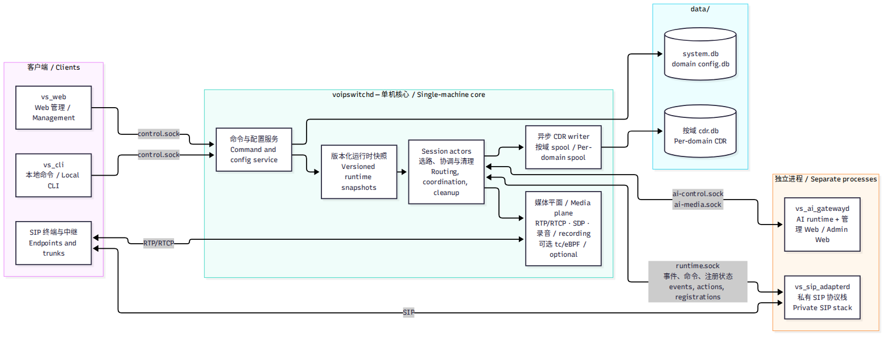

# VoIPSwitch Core

**面向单机部署的 Rust IPPBX 核心：呼叫、配置、媒体和 AI 集成。**

[English](README.md) | [简体中文](README_zh-CN.md) · [MIT 许可证](LICENSE)

VoIPSwitch 将 SIP 协议状态与 PBX 业务逻辑分离。本仓库构建核心守护进程 `voipswitchd`、本地管理客户端 `vs_cli`，以及用于本地演示和 CI 的 loopback 适配器 `vs_mock_adapterd`。Web 管理、SIP 适配和 AI 处理作为同机独立进程运行。

> 项目仍处于开发阶段。生产用 SIP 适配器使用私有 SIP 协议栈，不包含在本仓库中。`vs_mock_adapterd` 只验证运行时协议，不发送 SIP 和 RTP，是测试工具，不是生产适配器。

## 功能

- **呼叫：** 域内分机互拨、入出局中继、正则路由、顺序中继重试。
- **配置：** 写库前校验、版本化运行时快照；活动呼叫保留创建时解析的配置。
- **媒体：** 用户态 RTP/RTCP 转发、SDP 改写、早期媒体，以及可选的 IPv4 tc/eBPF 转发与降级。
- **录音与诊断：** 策略驱动的 G.711 双声道 WAV 录音、按域话单、SIP 呼叫流和媒体统计。
- **DTMF：** RFC4733 观察/收号和 SIP INFO 处理。
- **管理：** CLI 命令；独立 Web 服务提供配置和按域授权管理。
- **AI 集成：** 独立网关支持通话后分析、实时辅助和语音机器人。需要配置网关和 Provider；Core 不直接调用 Provider。

以上为系统能力，不代表仅运行 Core 就具备全部功能。域隔离不等于完整多租户运营平台。

## 架构



更多：[呼叫流程](docs/assets/call-flow.png) · [配置热更新](docs/assets/config-reload.png) · [RTP 快速转发](docs/assets/rtp-fast-path.png)

- 每条呼叫 leg 使用独立 session actor 和有界队列；coordinator 负责跨 leg 决策与清理。
- 配置写入统一经过命令/配置服务；呼叫选路读取快照，不查数据库。
- Core 拥有媒体转发、录音和话单；适配器拥有 SIP 鉴权、注册、事务和对话。
- AI Provider 执行属于网关；呼叫动作仍由 Core 校验和执行。

## 构建与运行

### 环境要求

- Linux，以及支持 Rust edition 2024 的当前 stable 工具链。
- 支持 BPF target 的 Clang：即使运行时只用用户态转发，当前构建脚本也会编译 eBPF 对象。

本仓库可独立构建，AI 协议类型已包含在 workspace 中。目前不承诺最低 Rust 版本和硬件容量。

在本仓库中运行：

```bash
cargo build --workspace
cargo run -p voipswitchd
```

另开终端，仍在本仓库中运行：

```bash
cargo run -p vs_cli -- -x "show status"
cargo run -p vs_cli -- -x "vc config"
# 交互式 CLI：
cargo run -p vs_cli
```

默认数据目录为 `data/`。Unix socket 默认位于 `$XDG_RUNTIME_DIR/voipswitch/`；未设置 `XDG_RUNTIME_DIR` 时使用 `/tmp/voipswitch/`。覆盖参数见各程序的 `--help`。

### 不接 SIP 适配器也能跑一通呼叫

`scripts/mock_call_demo.sh` 会在临时目录启动核心，创建演示域和分机 1001、1002，运行 `vs_mock_adapterd` 注册两端并发起一通呼叫，最后打印话单。全程不涉及 SIP 和 RTP，媒体统计保持为零。

```bash
bash scripts/mock_call_demo.sh
```

预期结果：一条 `answered: true`、`final_status: 200`、`hangup_cause: normal_clearing` 的话单。修改运行时、actor、FSM、CDR 或 spool 后，可用它做快速回归。

真实通话还需要取得并启动独立 SIP 适配器，配置域和两个分机，再注册 SIP 终端。可选的 `vs_web` 通常监听 18081；`vs_ai_gatewayd` 的独立管理界面监听 18082。以上命令不会启动这两个服务。对外部署前，应修改初始密码并保护管理入口。

## 开发检查

```bash
cargo fmt --all -- --check
cargo test --workspace
cargo clippy --workspace --all-targets -- -D warnings
# 按名称运行单个测试：
cargo test -p voipswitchd replacement_version_is_process_local_and_monotonic
```

[贡献说明](CONTRIBUTING_zh-CN.md)

## 范围与限制

当前重点是完善单机 IPPBX。HA 和跨主机部署暂缓，待实际项目需要时再设计。

不要假定已支持通用 SIP REFER 转接、振铃组、IVR、队列、语音信箱、会议、视频、WebRTC、SRTP 或转码。AI 机器人转分机不等于通用 SIP 转接。高级能力需要单独确认范围并验证。

## 性能

**待压测后补充。** 并发、呼叫建立延迟、丢包率、CPU 和内存数据必须附带可复现负载、硬件和内核信息，并分别说明用户态、快转、录音及 AI 模式。当前不发布容量或延迟指标。

## 许可证

本仓库使用 [MIT 许可证](LICENSE)。该授权不包含私有 SIP 适配器及其第三方协议栈；其他仓库与依赖遵循各自许可证。
